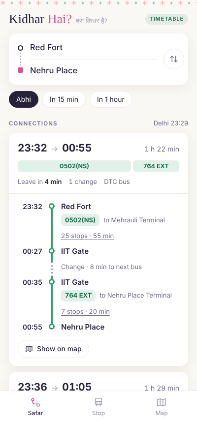
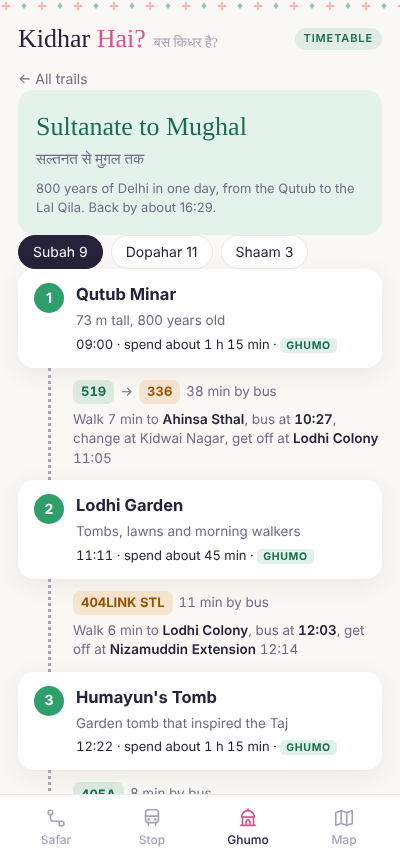
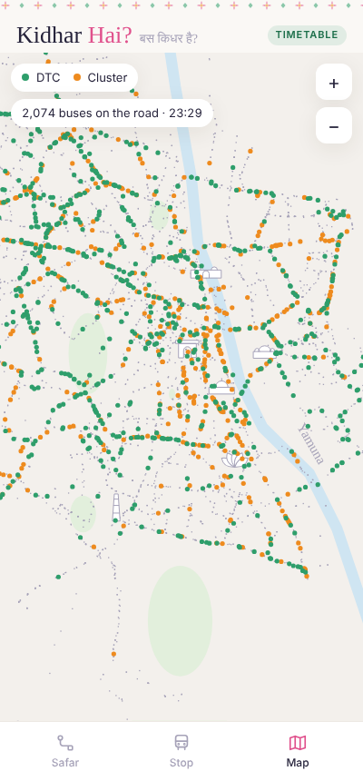

# Kidhar Hai? · बस किधर है?

A Delhi city bus planner built on the Delhi government's open transit data. Search any stop, get bus connections with changes, see the next buses from a stop, and watch every bus on a map at the position the timetable puts it right now. There's also **Ghumo**, a set of day trails around Delhi by city bus.

**Live demo:** https://kshatipra.github.io/kidhar-hai/

It's a single HTML file with no backend. All 6,342 stops and 78,507 daily trips are packed into the page (about 800 KB) and the routing runs in your browser.

| Safar (A → B) | Ghumo (day trails) | Map |
|---|---|---|
|  |  |  |

## What it does

- **Safar**: pick two stops and get the next connections, direct or with up to 2 changes. Each one shows departure, arrival, duration, route numbers, where to change, every stop in between, and the sights and food you pass on the way.
- **Stop**: a departure board for any stop, plus food and places within 1.5 km.
- **Ghumo**: four day trails (Mughal Delhi, Old Delhi food, bazaars, an evening walk) with the actual buses to take between stops.
- **Map**: all stops, the Yamuna, a few landmarks, and around 2,000 buses at their timetable positions. DTC buses are green and cluster buses are orange, like the real ones. Tap a stop or a bus for details.

## How it works

1. `scripts/build_data.py` reads a GTFS feed (stops, routes, trips, stop times) and compresses it. Every trip on a route in this feed has the same stop pattern and the same offsets, so a route is stored as one stop list, one offset list and a list of start times. That takes 3.3 million stop times down to under 2 MB of JSON, about 575 KB gzipped.
2. It also precomputes walking transfers between stops within 300 m.
3. `scripts/inject.py` embeds the gzipped data into the page as base64. The browser unpacks it with `DecompressionStream`.
4. Trip planning uses a small **RAPTOR** implementation (round-based public transit routing), up to 3 rounds, with walking transfers and a 1-minute change buffer. It keeps the Pareto-best journeys (fewer changes vs. earlier arrival) and reruns from later departure times to fill the list.
5. Bus positions on the map are interpolated between stops from the timetable, in Delhi time.

## Run it

Just open `index.html` in a browser. Nothing to install.

To rebuild the data from a newer GTFS download:

```bash
python3 scripts/build_data.py path/to/gtfs_folder delhi.json
gzip -9 -k delhi.json
python3 scripts/inject.py scripts/app.template.html delhi.json.gz index.html
```

## Live GPS (not wired in yet)

`server/feed.py` is a small FastAPI worker that polls Delhi's GTFS-Realtime vehicle positions every 10 seconds, drops GPS jumps and junk coordinates, flags stale buses and possible breakdowns, and serves one cached JSON to all clients. Phones never hit the government API directly, and the API key stays on the server.

```bash
pip install requests gtfs-realtime-bindings fastapi uvicorn
export OTD_KEY=your_key_from_otd.delhi.gov.in   # never commit this
cd server && uvicorn feed:app --port 8000
```

## Limits

- The timetable is from the Delhi OTD static feed, valid **2022–2024**. Some routes will have changed.
- OTD says its stop times are rough estimates that assume constant speed. Treat times as a guide.
- No live delays yet. That needs `feed.py` running somewhere.
- Route lines on the map are straight between stops (the feed has no shapes).
- The trails and place descriptions are hand-picked and worth double-checking.

## Data and credits

- Bus stops, routes and timetable: [Delhi Open Transit Data](https://otd.delhi.gov.in/) (Transport Department, GNCTD, with IIIT-Delhi), covering DTC and DIMTS cluster buses. Used under the [OTD terms](https://otd.delhi.gov.in/terms). The copy used here came from the [Transitland GTFS archive](https://github.com/transitland/gtfs-archives-not-hosted-elsewhere) because the OTD download was returning errors.
- Fonts: [Mukta](https://fonts.google.com/specimen/Mukta) and [Yatra One](https://fonts.google.com/specimen/Yatra+One) via Google Fonts.

Not affiliated with DTC, DIMTS or the Delhi government.

---

Built by [Pratiksha (Ksha)](https://kshatipra.github.io/Portfolio/).
